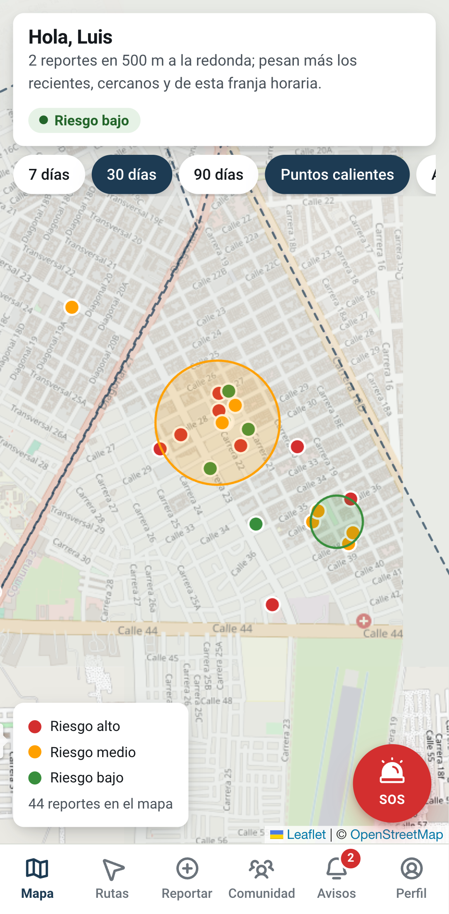
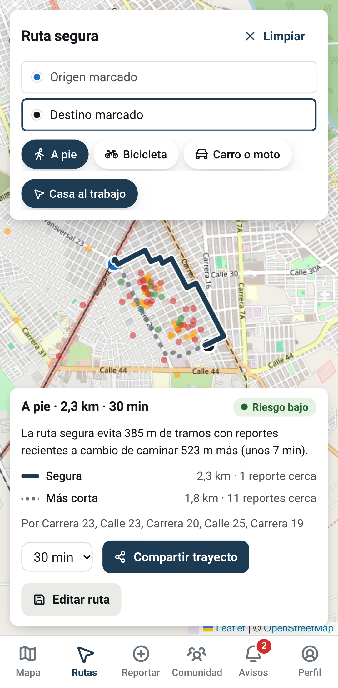
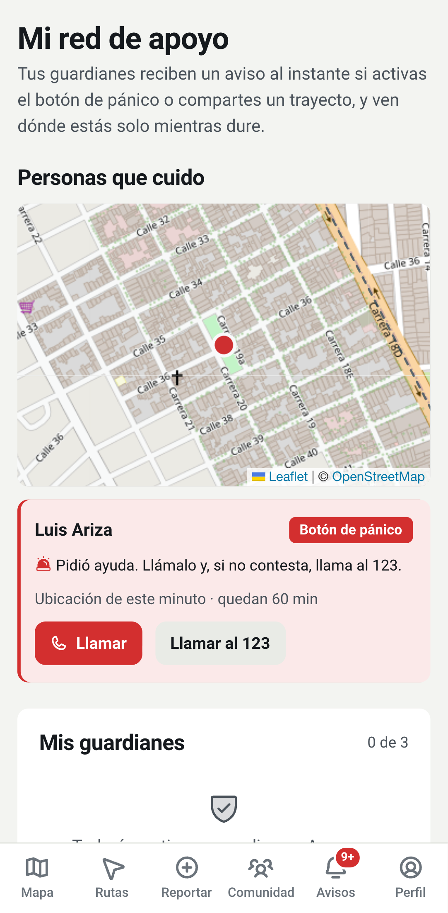
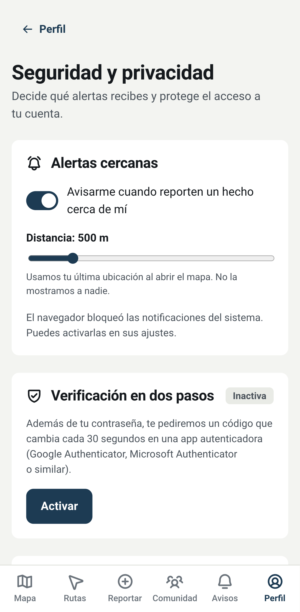

# AlertApp Valledupar

[](https://github.com/HernandoMendozaIng/alertapp-valledupar/actions/workflows/pruebas.yml)

Prototipo funcional (TRL 5) de una plataforma móvil y web basada en geolocalización e inteligencia artificial
para fortalecer la prevención situacional del delito en las Comunas 3 y 4 de Valledupar.

Proyecto de grado, Ingeniería de Sistemas, Universidad Nacional Abierta y a Distancia (UNAD), curso 202016907.
Autores: Armel Peña Rangel y Hernando Mendoza. Tutor: Orlando Gómez Barboza.

<p>
  
  
  
  
</p>

## Qué hace

Las 13 historias de usuario del documento maestro funcionan de extremo a extremo:

| Historia de usuario | Función en el prototipo |
|---|---|
| HU 01 Acceso y autenticación | Registro con aceptación de la Ley 1581, ingreso con JWT, recuperación de la contraseña con código |
| HU 02 Alertas geolocalizadas | Aviso en tiempo real cuando reportan algo cerca (radio de 200 m a 2 km, se puede apagar) |
| HU 03 Zonas de riesgo (hotspots) | Mapa con los límites de las Comunas 3 y 4, puntos calientes por color y filtro a 200 m |
| HU 04 Rutas seguras | Ruta que evita zonas con reportes, a pie, en bicicleta o en vehículo, comparada con la más corta |
| HU 05 Reporte guiado | Tipo, arma, medio, elemento, fecha, ubicación, foto opcional y anonimato por defecto |
| HU 06 Rutas frecuentes y seguimiento | Guardar trayectos y compartir la ubicación con los guardianes hasta por una hora |
| HU 07 Validación comunitaria | Votos de confirmación o falso, validación y anulación automática con 3 votos de diferencia |
| HU 08 Métricas y filtros | Reportes por hora, día, tipo y comuna con filtros sin recargar |
| HU 09 Reportes para autoridades | Exportación CSV para Excel e informe semanal imprimible en PDF |
| HU 10 Seguridad de la cuenta | Verificación en dos pasos con app autenticadora (TOTP), cambio de clave y de correo |
| HU 11 Botón de pánico | Cuenta de 5 segundos para cancelar, ubicación al panel de la autoridad y a los guardianes |
| HU 12 Red de guardianes | Hasta 3 personas de confianza que reciben el pánico al instante y ven la ubicación en vivo |
| HU 13 Trazabilidad | Estados del caso con notas de la autoridad y aviso al ciudadano en cada cambio |

La IA está en un microservicio de Python que agrupa los reportes con DBSCAN (scikit-learn, distancia haversine)
y calcula un índice de riesgo por ubicación y hora. Si ese servicio no responde, la API usa un respaldo en Java
con la misma lógica. Las rutas seguras usan el algoritmo A* sobre la red vial de OpenStreetMap, donde cada tramo
de calle "pesa" más según los reportes recientes que tiene cerca.

**Qué es simulado en el prototipo:** los datos son sintéticos (no son denuncias reales), los correos de
recuperación se escriben en el registro del servidor en lugar de enviarse, y las alertas llegan mientras la app
está abierta (con la app cerrada se necesita push nativo). Todo eso tiene su reemplazo en la arquitectura objetivo
en AWS; ver [docs/arquitectura.md](docs/arquitectura.md).

## Arquitectura

```
React + Leaflet (web móvil)  --->  API REST Spring Boot (Java 21)  --->  PostgreSQL 17
        :5173          <--- SSE ---    :8080   |                         (Flyway)
                                               +--->  Microservicio IA (Python, FastAPI, scikit-learn) :8000
```

Diagramas de componentes, casos de uso, secuencia y el modelo entidad-relación en [docs/arquitectura.md](docs/arquitectura.md).
Referencia de la API en [docs/api.md](docs/api.md).

## Cómo ejecutarlo

Requisitos: Java 21, Maven 3.9+, Python 3.11+, Node 20+ y PostgreSQL 15+.

```bash
# 1. Base de datos
createuser alertapp --pwprompt        # contraseña: alertapp
createdb alertapp -O alertapp

# 2. Los tres servicios
./scripts/iniciar.sh
```

Abre http://localhost:5173. La primera vez se cargan datos de prueba sintéticos (154 reportes dentro de las
Comunas 3 y 4) y estas cuentas, todas con la contraseña `Valledupar2026`:

| Rol | Correo | Para probar |
|---|---|---|
| Ciudadano | ciudadano@alertapp.co | Luis Ariza: reportar, rutas, pánico; tiene 2 guardianes y la ruta "Casa al trabajo" |
| Guardián | vecino1@alertapp.co | Marta Oñate: guardiana de Luis; en "Mi red de apoyo" lo ve en vivo si pide ayuda |
| Autoridad | autoridad@alertapp.co | Panel, alertas, cambio de estado, CSV e informe semanal |

Hay seis vecinos de prueba (`vecino1` a `vecino6@alertapp.co`) para votar y probar las alertas cercanas.
Para dejar la base como nueva antes de una demostración: `./scripts/reiniciar-datos.sh` y reiniciar la API.

La documentación interactiva de la API queda en http://localhost:8080/docs.

## Pruebas

71 pruebas automáticas, todas aprobadas:

```bash
cd backend && mvn test                         # 44 pruebas de la API: unitarias y funcionales de extremo a extremo
cd ia-service && .venv/bin/python -m pytest    # 5 pruebas del modelo de IA
cd frontend && npm run test:e2e                # 22 pruebas de interfaz con Playwright (servicios en marcha)
```

La prueba `LatenciaAlertasTest` mide el criterio de la HU 02: la alerta llega en menos de 5 segundos (en las
corridas, menos de 0,05 s). El protocolo y los resultados están en [docs/pruebas-funcionales.md](docs/pruebas-funcionales.md).
`scripts/carga/prueba_carga.py` mide el RNF-01: con 10 transacciones por segundo durante un minuto no hubo
errores y el 95 % de las respuestas tardó 22 ms o menos.
GitHub Actions corre las pruebas de la API, de la IA y la compilación de la web en cada cambio a `main`.

`npm run capturas` (en `frontend/`) vuelve a generar las imágenes de [docs/capturas](docs/capturas).

## Metodología

Scrum con sprints cortos. Backlog, planificación de sprints, bitácora de daily scrum e incrementos en
[docs/scrum/](docs/scrum/). Cómo trabajar en el repositorio: [CONTRIBUTING.md](CONTRIBUTING.md).

## Estructura

```
backend/        API REST (Spring Boot, JPA, Spring Security, Flyway)
  .../ruta/         Red vial en memoria, mapa de riesgo por tramo y A*
  .../notificacion/ Canal en tiempo real (SSE) y alertas por cercanía
  .../guardian/     Red de apoyo
  .../seguimiento/  Rutas frecuentes y ubicación compartida
ia-service/     Microservicio de analítica e IA (FastAPI, scikit-learn)
frontend/       Aplicación web móvil y panel de autoridad (React, TypeScript, Leaflet)
  e2e/              Pruebas de interfaz con Playwright
docs/           Arquitectura, API, pruebas funcionales, capturas y artefactos Scrum
scripts/        Arranque local, reinicio de datos y construcción de la red vial
```

## Datos geográficos

Los límites de las comunas y la red vial provienen de OpenStreetMap (© colaboradores de OpenStreetMap, licencia
ODbL). OpenStreetMap no tiene la Comuna 4 como relación propia; se obtuvo restando las Comunas 1, 2, 3, 5 y 6 del
perímetro urbano de Valledupar. La red vial (5 275 cruces y 8 142 tramos) se arma con
`scripts/datos/construir_red_vial.py`.
