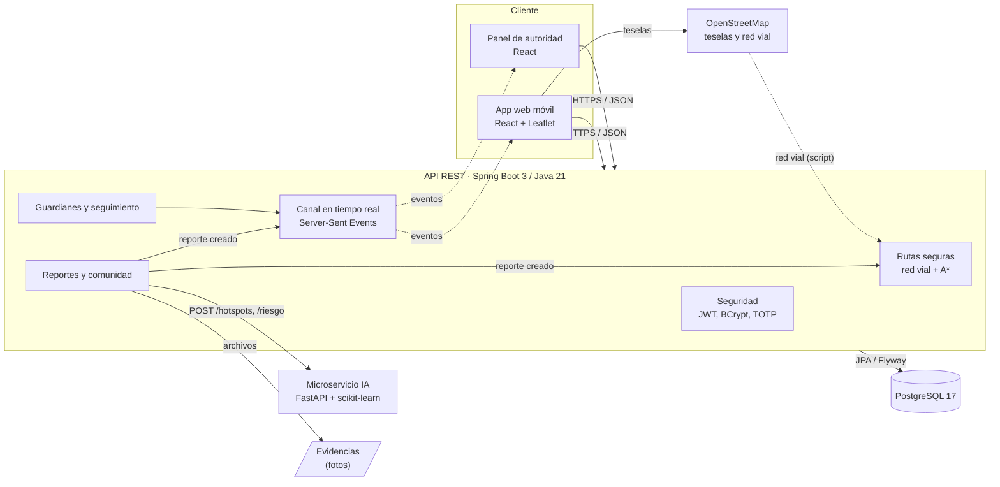
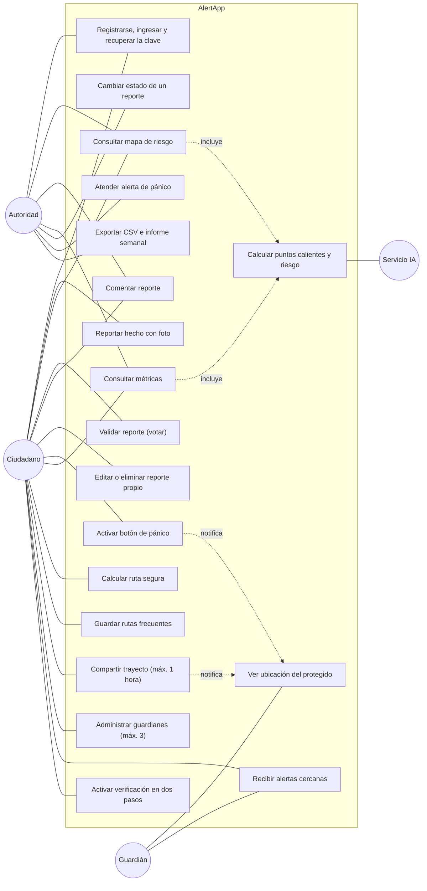
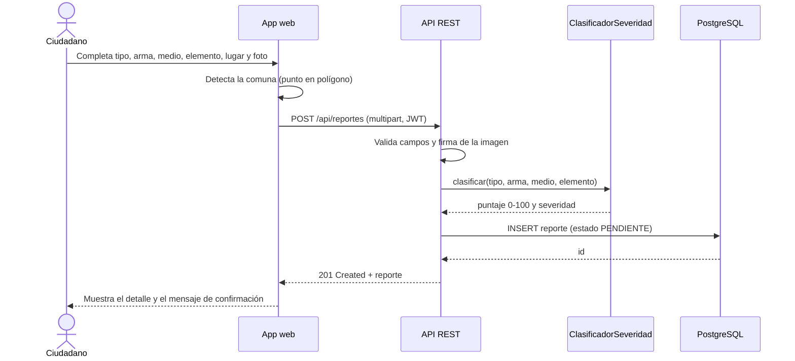
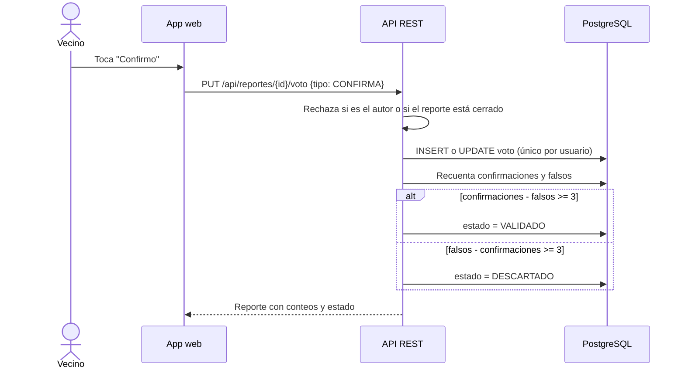
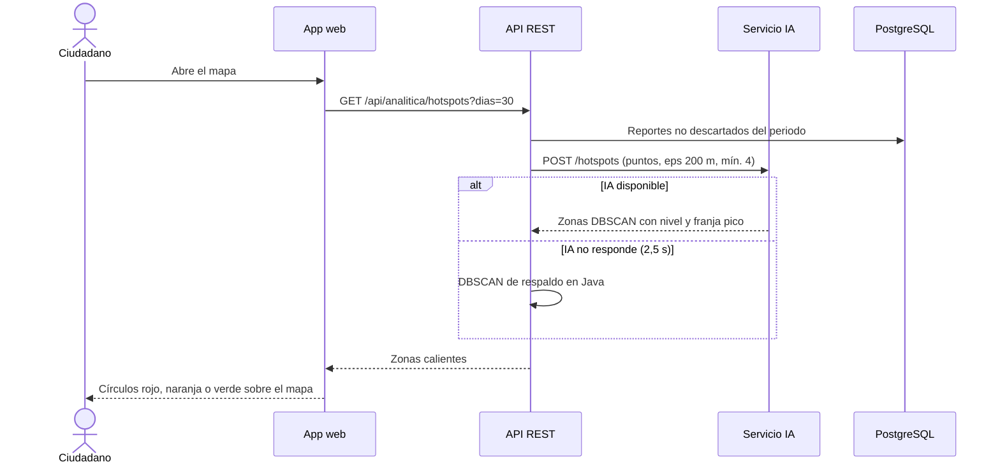
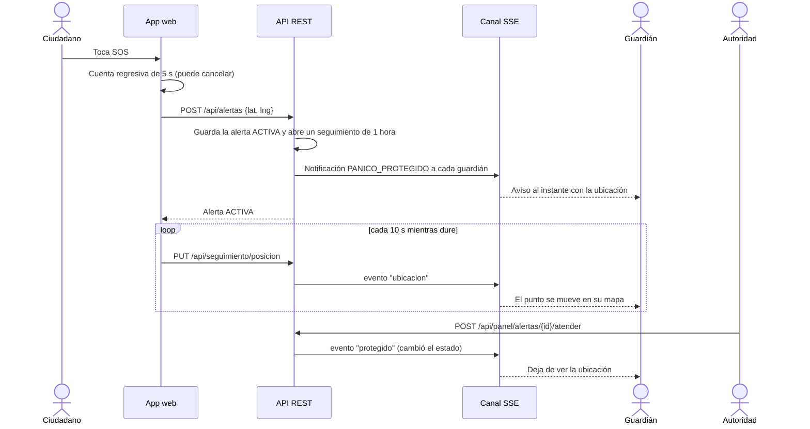
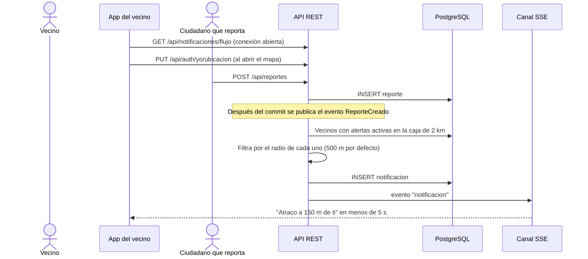
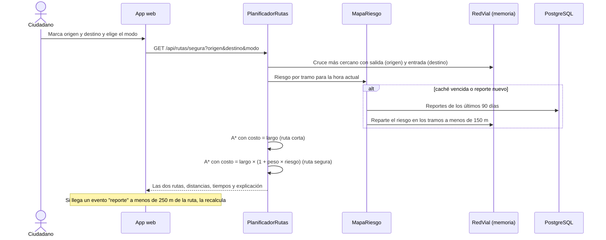
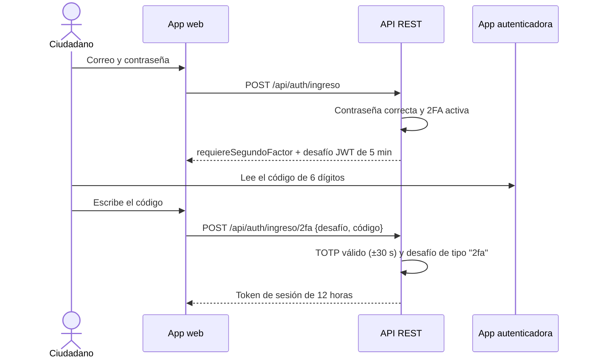
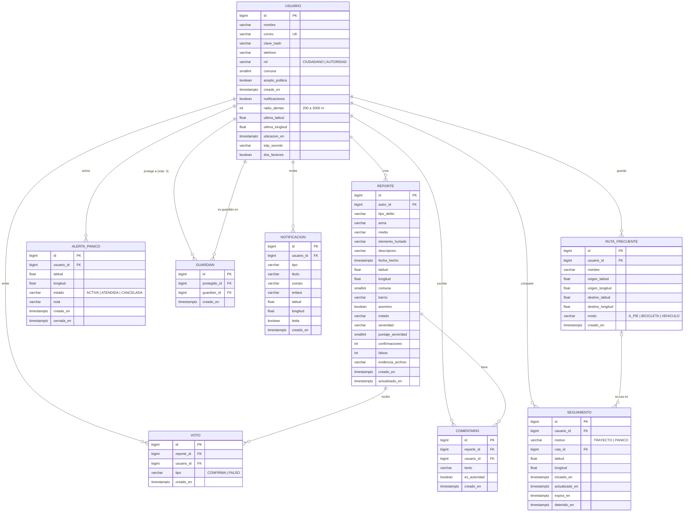

# Arquitectura y diseño

## 1. Arquitectura objetivo y arquitectura del prototipo

El documento maestro define una arquitectura objetivo en AWS (EKS, Aurora PostgreSQL, Cognito, S3).
Para validar el nivel TRL 5 se construyó el mismo diseño de componentes en un entorno local, con los
mismos lenguajes (Java para la API, Python para la IA, React para la interfaz y PostgreSQL para los datos).
Cada componente local tiene su reemplazo directo en la nube:

| Componente del prototipo | Equivalente en la arquitectura objetivo |
|---|---|
| API REST Spring Boot en un proceso | Microservicios Java en contenedores sobre Amazon EKS |
| PostgreSQL 17 local con Flyway | Amazon Aurora PostgreSQL |
| JWT firmado por la API (HMAC) | AWS Cognito |
| Carpeta local de evidencias | Amazon S3 |
| Microservicio FastAPI local | Servicio de IA en contenedor (o SageMaker) |
| Mapa OpenStreetMap + Leaflet | APIs de ArcGIS (ESRI) |
| Rutas seguras con A* sobre la red vial de OpenStreetMap | Servicio de rutas de ArcGIS con capa de riesgo |
| Canal en tiempo real con Server-Sent Events | Notificaciones push con Firebase Cloud Messaging o Amazon SNS |
| TOTP (RFC 6238) implementado en la API | Autenticación multifactor de AWS Cognito |
| Mensajes de recuperación escritos en el registro del servidor | Amazon SES (correo) y Amazon SNS (SMS) |
| Web adaptable al celular | App Android híbrida + panel React |

## 2. Diagrama de componentes

La red vial se descarga una sola vez con `scripts/datos/construir_red_vial.py` y queda como archivo dentro de la
API (`backend/src/main/resources/geo/red-vial.json`), así que las rutas no dependen de ningún servicio externo.

## 3. Casos de uso

El guardián es un ciudadano registrado que otro usuario eligió como persona de confianza: la misma cuenta puede
ser protegido y guardián a la vez.

## 4. Diagramas de secuencia

### 4.1 Reporte guiado (HU 05)

### 4.2 Validación comunitaria (HU 07)

### 4.3 Mapa de riesgo con IA (HU 03)

### 4.4 Botón de pánico con guardianes (HU 11 y HU 12)

### 4.5 Alerta geolocalizada (HU 02)

### 4.6 Ruta segura (HU 04)

### 4.7 Ingreso con verificación en dos pasos (HU 10)

## 5. Modelo entidad-relación

Restricciones principales (ver `V1__esquema_inicial.sql` y `V2__seguridad_personal.sql` en
`backend/src/main/resources/db/migration/`): voto único por usuario y reporte, dominios de estado, severidad,
rol, tipo de notificación y modo con `CHECK`, aceptación obligatoria de la política de datos, un guardián no
puede ser la misma persona (`ck_guardian_distinto`) ni repetirse (`uq_guardian`), el seguimiento nunca dura más
de una hora (`ck_seguimiento_duracion`) y el radio de alertas va de 200 m a 2 km. El límite de 3 guardianes se
valida en el servicio porque depende de cuántas filas ya existen.

## 6. Modelo de severidad y de riesgo

**Severidad del reporte (0 a 100).** Suma de pesos: arma (fuego 50, cortopunzante 35, no identificada 15,
sin arma 5), tipo (atraco 25, hurto 10, otro 5, sospechoso 0), medio (moto o carro 10, bicicleta o no
identificado 5) y elemento (moto o carro 15, celular, joyas o dinero 8, bicicleta o partes 6, otros 3).
Alta desde 60, media desde 30.

**Puntos calientes.** DBSCAN con distancia haversine, radio de 200 m y mínimo 4 reportes. Cada zona recibe un
puntaje de hasta 50 por volumen, 30 por severidad media y 20 por actividad del último mes; alto desde 60,
medio desde 35. La franja pico es el bloque de 4 horas con más reportes.

**Índice de riesgo de una ubicación.** Suma ponderada de los reportes a menos de 500 m: cercanía
`e^(-d/250)`, vida media de 30 días, similitud de hora gaussiana con desviación de 2 h y severidad. El índice es
`100·(1 − e^(−suma/1,5))`; alto desde 60, medio desde 30.

**Riesgo de cada tramo de calle (rutas seguras).** Cada reporte no descartado de los últimos 90 días aporta a los
puntos de la red vial que tiene a menos de 150 m un peso de `severidad × validación × recencia × franja × (1 − d/150)`,
donde la severidad vale 1 (alta), 0,65 (media) o 0,35 (baja); la validación 1,25 si la comunidad o la autoridad ya
lo confirmaron; la recencia tiene una vida media de 45 días, y la franja vale 1,4 si el hecho ocurrió a dos horas
o menos de la hora actual. El riesgo del tramo es el de su punto más peligroso, con un tope de 4.

**Costo de la ruta segura.** `largo × (1 + peso del modo × riesgo del tramo)`. El peso es 2,2 a pie, 1,6 en
bicicleta y 0,9 en vehículo, porque quien camina está más expuesto. A pie se ignora el sentido de las calles; en
bicicleta y en vehículo se respeta, y el carro no entra a senderos ni pasajes peatonales. La ruta más corta usa el
mismo algoritmo con peso 0, para poder comparar las dos.

**Alertas por cercanía.** Se avisa a quien activó las alertas, tiene una ubicación de las últimas 12 horas y está
dentro de su radio. La distancia se muestra redondeada (10 m, 50 m o 0,1 km) para no revelar el punto exacto
del reporte.
