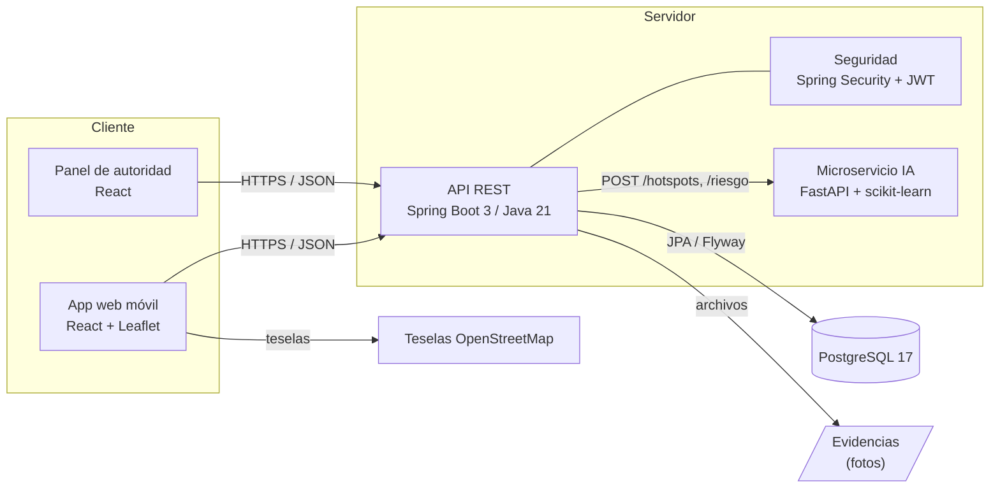
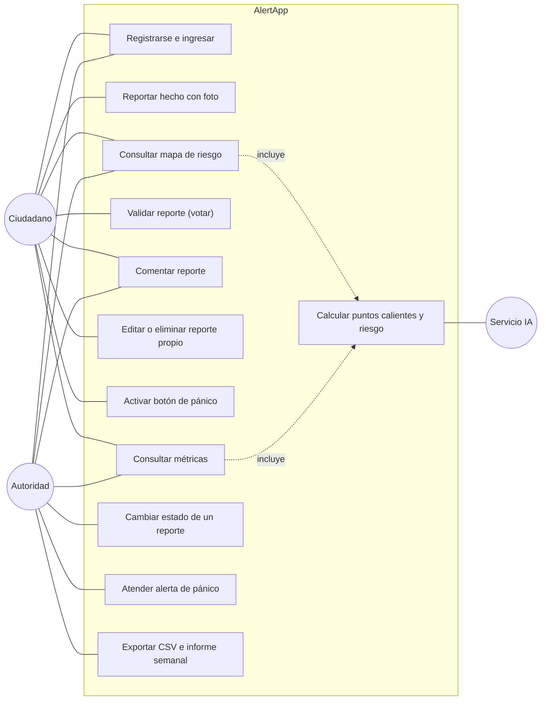
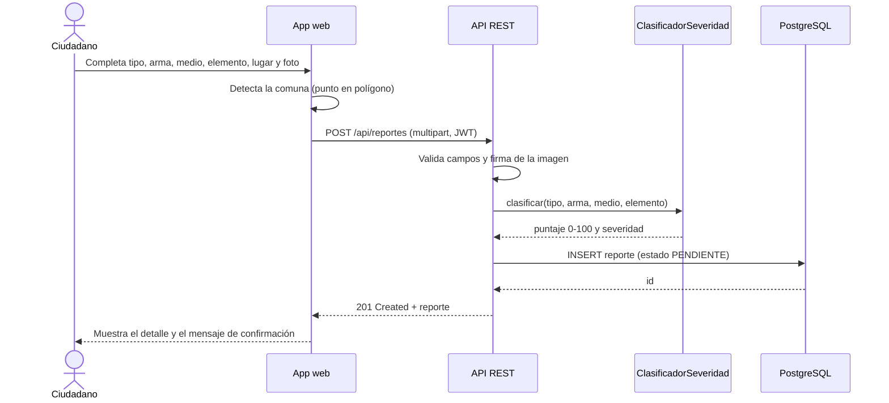
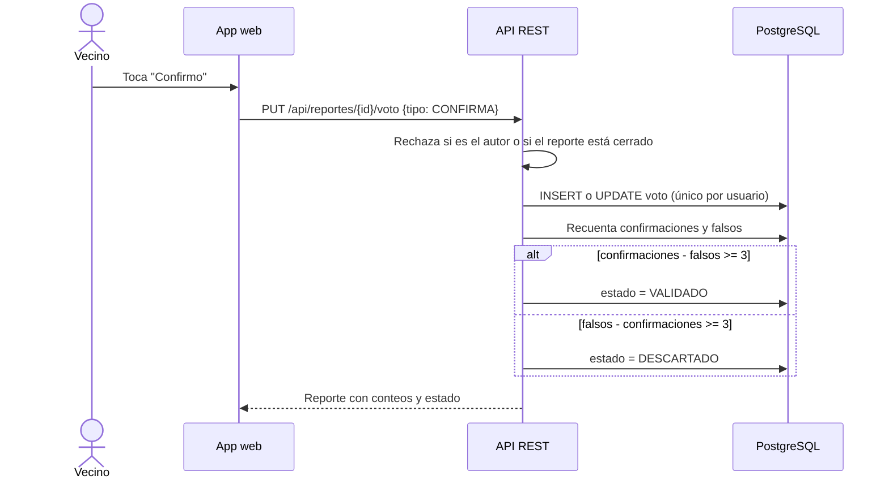
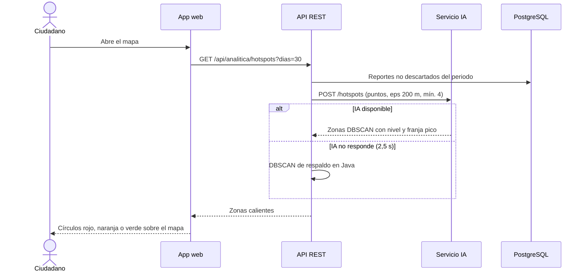
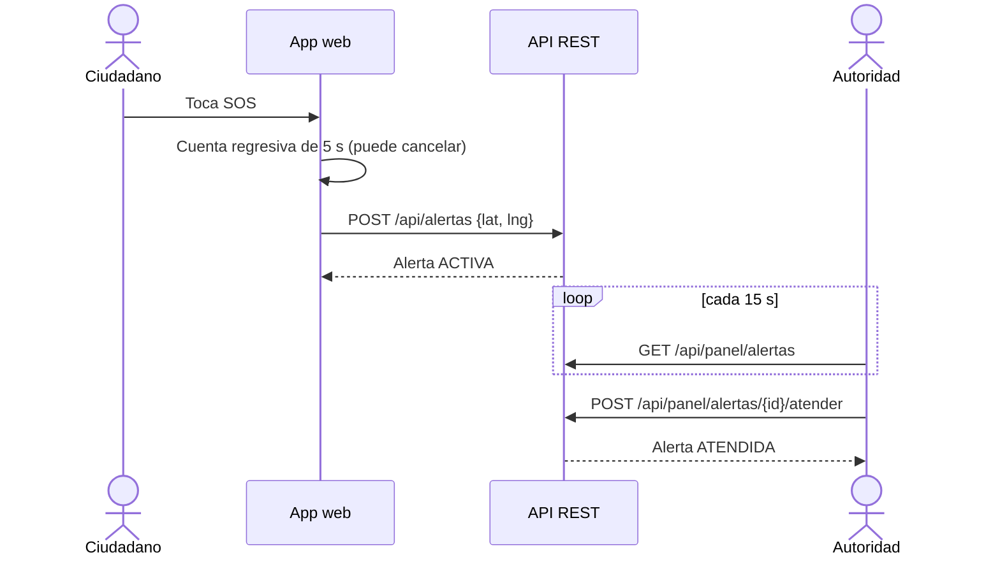
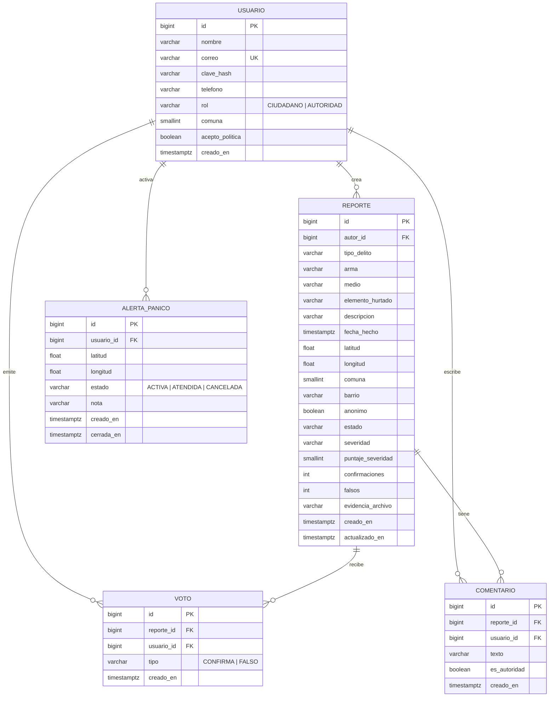

# Arquitectura y diseño

## 1. Arquitectura objetivo y arquitectura del prototipo

El documento maestro define una arquitectura objetivo en AWS (EKS, Aurora PostgreSQL, Cognito, S3).
Para validar el nivel TRL 5 se construyó el mismo diseño de componentes en un entorno local, con los
mismos lenguajes (Java para la API, Python para la IA, React para la interfaz y PostgreSQL para los datos).
Cada componente local tiene su reemplazo directo en la nube:

| Componente del prototipo | Equivalente en la arquitectura objetivo |
|---|---|
| API REST Spring Boot en un proceso | Microservicios Java en contenedores sobre Amazon EKS |
| PostgreSQL 17 local con Flyway | Amazon Aurora PostgreSQL |
| JWT firmado por la API (HMAC) | AWS Cognito |
| Carpeta local de evidencias | Amazon S3 |
| Microservicio FastAPI local | Servicio de IA en contenedor (o SageMaker) |
| Mapa OpenStreetMap + Leaflet | APIs de ArcGIS (ESRI) |
| Web adaptable al celular | App Android híbrida + panel React |

## 2. Diagrama de componentes

## 3. Casos de uso

## 4. Diagramas de secuencia

### 4.1 Reporte guiado (HU 05)

### 4.2 Validación comunitaria (HU 07)

### 4.3 Mapa de riesgo con IA (HU 03)

### 4.4 Botón de pánico (HU 11)

## 5. Modelo entidad-relación

Restricciones principales (ver `backend/src/main/resources/db/migration/V1__esquema_inicial.sql`):
voto único por usuario y reporte (`uq_voto_reporte_usuario`), dominios de estado, severidad y rol con `CHECK`,
aceptación obligatoria de la política de datos y borrado en cascada de votos y comentarios.

## 6. Modelo de severidad y de riesgo

**Severidad del reporte (0 a 100).** Suma de pesos: arma (fuego 50, cortopunzante 35, no identificada 15,
sin arma 5), tipo (atraco 25, hurto 10, otro 5, sospechoso 0), medio (moto o carro 10, bicicleta o no
identificado 5) y elemento (moto o carro 15, celular, joyas o dinero 8, bicicleta o partes 6, otros 3).
Alta desde 60, media desde 30.

**Puntos calientes.** DBSCAN con distancia haversine, radio de 200 m y mínimo 4 reportes. Cada zona recibe un
puntaje de hasta 50 por volumen, 30 por severidad media y 20 por actividad del último mes; alto desde 60,
medio desde 35. La franja pico es el bloque de 4 horas con más reportes.

**Índice de riesgo de una ubicación.** Suma ponderada de los reportes a menos de 500 m: cercanía
`e^(-d/250)`, vida media de 30 días, similitud de hora gaussiana con desviación de 2 h y severidad. El índice es
`100·(1 − e^(−suma/1,5))`; alto desde 60, medio desde 30.
